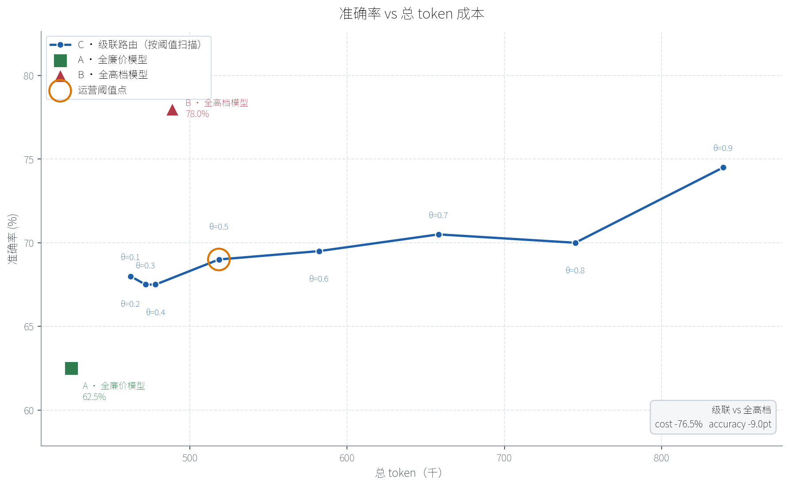
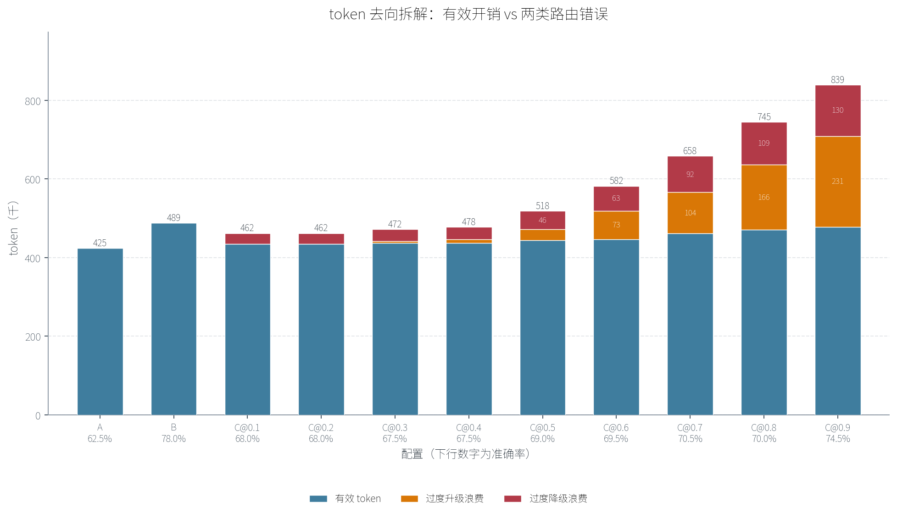
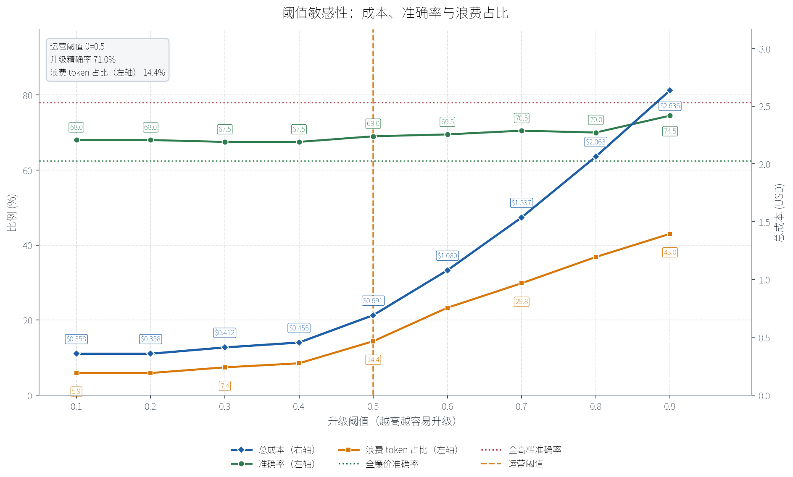

# route-audit · 模型路由策略的离线审计与 token 代价归因沙盒

> **一句话结论**：级联路由比全高档模型省了 **76.5%** 的钱，但它为"同样的准确率"付了 **2.69 倍**的代价。
> **62.8% 的级联支出是路由决策错误造成的**，不是模型本身贵。
> 现有工具（Strands CostGuard、AgentFuse）报告"省了多少"；本项目回答的是**"路由错花了多少"**。

参考：[Strands CostGuard](https://strandsagents.com/) 提供预算强制执行与自适应模型路由，在预算阈值触发时自动降级模型；
[AgentFuse](https://arxiv.org/) 报告 85% 的路由节省与 87.5% 的缓存命中率。两者都以"节省额"为一等公民指标。
本项目把**路由错误本身**作为审计对象。

---

## 1. 为什么需要"路由错误审计"

成本感知路由的标准叙事是：

```
用了 cascade 路由 → 省了 76% 的钱 → 好！
```

这句话在数学上没错，但它**没有分母**。省 76% 是相对什么？相对"全部用最贵的模型"——
那是个没人会选的基线。真正该问的是：

1. 这个准确率，**理论上最低要花多少钱**？
2. 实际花了多少？差额去哪了？
3. 差额里，多少是**过度升级**（本来答对却被升级），多少是**过度降级**（本来答错、白烧一次廉价调用）？

在线路由无法回答第 1 和第 3 个问题，因为它不知道答案。**离线审计知道答案**——
标注集给出了 gold label，所以每一次廉价尝试都可以被事后评分，
包括那些路由器从未升级、但其实是错的任务。这就是本项目的方法论基础。

### 核心机制：反事实矩阵（counterfactual matrix）

```
对每个任务 t：
    cheap_verdict(t)   ← 策略 A 的结果（廉价模型答对/答错）
    premium_verdict(t) ← 策略 B 的结果（高档模型答对/答错）
```

有了这个 2×2 矩阵，任意阈值下的级联结果都是**纯重放**：
廉价尝试复用，只对门控触发的任务真正调用高档模型。所以：

- 3 个阈值不是 3 次部署，而是 1 次矩阵 + 3 次重放
- 一次 9 阈值扫描只花 **537 次真实调用**（而非 4000 次），461 次命中缓存
- **任何**阈值配置的成本/准确率都可以从 `audit.json` 离线重算，零 token

> **关键工程细节**：模拟器的"答对/答错"与"格式是否崩坏"都用 **不含 stage 的种子** 生成，
> 因此升级调用必然是策略 B 那个反事实的有效采样。
> 这保证了 `escalated_attempt.verdict == 策略B.verdict` 在全部 461 次升级上 **100% 成立**。
> 如果 stage 参与种子，`premium_verdict` 描述的就不是升级真正产生的那个答案，
> 整个归因会退化成在测量噪声。

---

## 2. 三种策略与门控设计

| 策略 | 说明 | 调用模式 |
|---|---|---|
| **A** | 全廉价模型（`gpt-4o-mini`） | 每任务 1 次廉价调用 |
| **B** | 全高档模型（`gpt-4o`） | 每任务 1 次高档调用 |
| **C** | 级联路由 | 廉价 → 门控 → 必要时升级 |

策略 C 的门控是**无标签**的，只能看两个可观测信号（`routeaudit/confidence.py`）：

1. **格式门控**（优先）：答案无法解析 → 无条件升级。免费、能抓截断和格式崩坏。
2. **置信度门控**：模型自报的 `Confidence:` 值低于阈值 → 升级。

关键设计取舍：**门控信号本身是有偏的**。廉价模型系统性过度自信
（本审计测得 **ECE = 0.139**，平均置信度 **0.764** vs 实际准确率 **0.665**，偏差 **+0.099**），
所以"凭感觉定 0.5 阈值"必然过度升级。审计的价值就在于把这个偏差**量化**出来。

---

## 3. 每一步的 token 归因

`routeaudit/accounting.py` 的 `TokenBreakdown` 从不把廉价尝试和升级调用合并成一个数字：

```
TokenBreakdown:
    primary_prompt_tokens / primary_completion_tokens      ← 廉价尝试
    escalated_prompt_tokens / escalated_completion_tokens  ← 升级触发
    total = primary + escalated
```

每个任务产出 `TaskAttribution`，把 token 分成**四类**路由结果：

| 类别 | 判定条件 | 含义 |
|---|---|---|
| **过度升级浪费** | `cheap_correct=True and escalated=True` | 高档调用纯属浪费，廉价答案本来就对 |
| **过度降级浪费** | `cheap_correct=False and escalated=True` | 廉价调用颗粒无收，是升级之外的双倍开销 |
| **漏升级** | `cheap_correct=False and escalated=False` | 静默发错答案，不烧 token 但错得理直气壮 |
| **有害升级** | `cheap_correct=True and escalated=True and final_wrong` | **花钱把对的答案改错了** |

最后一行是本项目额外发现的第四类错误，任何成本指标都看不见它：
升级通常被描述为"用钱买准确率"，但当高档模型在某题上恰好答错、而廉价模型答对时，
路由器**既付了钱又丢了准确率**。这就是为什么**级联准确率不是阈值的单调函数**（见 §4.3）。

两个"率"必须区分清楚（brief 里容易混淆）：

- **过度升级率** = 不必要的升级 / 总升级数 → 回答"门控有多吵"
- **过度降级率** = 因廉价答错而升级的任务 / 总任务数 → 回答"路由起点有多低"

---

## 4. 实测结果

**配置**：200 任务（50% QA / 30% MATH / 20% Code）· seed=20260101 · `gpt-4o-mini` vs `gpt-4o` · 9 阈值扫描

### 4.1 三策略对比

| 配置 | 准确率 | 总 token | 成本 (USD) | 每正确 token | 每正确成本 | 浪费 token 占比 |
|---|---:|---:|---:|---:|---:|---:|
| A · 全廉价 | 62.5% | 424,527 | $0.1250 | 3,396 | $0.00100 | — |
| B · 全高档 | 78.0% | 488,580 | $2.9457 | 3,132 | $0.01888 | — |
| **C · 级联 @0.3** | 67.5% | 471,670 | $0.4124 | 3,494 | $0.00305 | 7.4% |
| **C · 级联 @0.5** | 69.0% | 518,384 | $0.6911 | 3,756 | $0.00501 | 14.4% |
| **C · 级联 @0.7** | 70.5% | 658,114 | $1.5367 | 4,667 | $0.01090 | 29.8% |

- 级联 vs 全高档：**省 76.5%**，准确率低 **9.0 pp**
- 级联 vs 全廉价：成本 **5.53×**，准确率仅高 **6.5 pp**
- 级联 vs 全高档：**token 多 6.1%**（是的，级联比全高档用的 token 更多）



*三种策略在「准确率 vs 总 token」平面上的位置。A 与 B 是单点，C 是随阈值移动的曲线。
级联曲线整体位于 A→B 连线的**右下方**——这就是"省了钱但没省 token"的几何解释，
也是本图最重要的读法：曲线没有贴着对角线走，说明路由效率仍有损失。*

> 最后一行很反直觉，但它是本项目的一个独立发现：
> **级联省下的是钱，不是 token。** 廉价阶段在*每个*任务上都要付一次，
> 而被升级的任务又要再付一次高档调用，所以总 token 反而更高。
> 任何用"token 消耗"来论证路由节省的说法，在这个配置下都是错的。

### 4.2 路由错误代价归因（阈值 0.5）— **核心结论**

| 错误类型 | 任务数 | token | token 占比 | 成本 (USD) | 成本占比 |
|---|---:|---:|---:|---:|---:|
| 过度升级（白升级） | 9 | 28,457 | 5.5% | $0.1683 | **24.4%** |
| 过度降级（双倍开销） | 22 | 45,980 | 8.9% | $0.0140 | 2.0% |
| 漏升级（静默错误） | 53 | 113,986 | 22.0% | — | — |
| **合计浪费** | 31 | **74,437** | **14.4%** | **$0.1823** | **26.4%** |

**这就是"过度降级的隐藏 token 代价"：**

> 级联在阈值 0.5 下升级了 31 次，其中只有 22 次是必要的
> （`escalation_precision = 71.0%`）。另外 9 次是纯浪费。
>
> 更关键的是**非对称性**：过度升级只占 token 的 **5.5%**，却占了**成本的 24.4%**；
> 过度降级占 token 的 **8.9%**，却只占成本的 **2.0%**。
> 原因很简单——高档模型比廉价模型贵 **16.67 倍**（blended price ratio）。
>
> 所以"过度升级率 29.0%"和"过度升级成本占比 24.4%"是两个必须分开报的数字。
> 只报前者会低估严重性（看起来只是三分之一的升级浪费了），
> 只报后者会掩盖它其实只发生在 9 个任务上。
>
> **更被忽视的是漏升级：53 个任务（26.5%）廉价模型答错了、却没有触发升级，
> 直接发出错误答案。** 这部分不烧额外 token，所以任何"token 成本"指标都看不见它——
> 但它才是准确率损失的主要来源。



*每个配置的 token 去向：蓝色是有效开销，橙色是过度升级浪费，红色是过度降级浪费。
两根柱子的总高度告诉你"花了多少 token"，只有蓝段告诉你"买到了多少有效工作"。
随着阈值升高，柱子越长而蓝段几乎不变——多出来的部分全在付路由错误。*

### 4.3 阈值敏感性

| 阈值 | 准确率 | 总 token | 成本 | 升级率 | 过度升级率 | 过度降级率 | 浪费 token 占比 | 边际成本/pp |
|---:|---:|---:|---:|---:|---:|---:|---:|---:|
| 0.1 | 68.0% | 462,171 | $0.3578 | 6.5% | 0.0% | 6.5% | 5.9% | — |
| **0.3** | 67.5% | 471,670 | $0.4124 | 8.0% | 12.5% | 7.0% | 7.4% | −$10.92 |
| **0.5** | 69.0% | 518,384 | $0.6911 | 15.5% | 29.0% | 11.0% | 14.4% | $15.77 |
| **0.7** | 70.5% | 658,114 | $1.5367 | 38.0% | 43.4% | 21.5% | 29.8% | $45.69 |
| 0.8 | 70.0% | 745,114 | $2.0632 | 52.5% | 51.4% | 25.5% | 36.8% | **−$105.30** |
| 0.9 | 74.5% | 839,179 | $2.6358 | 68.5% | 55.5% | 30.5% | 43.0% | $12.73 |

**把阈值从 0.5 调到 0.7：**

- 成本：$0.6911 → $1.5367（**+122.4%**）
- 准确率：69.0% → 70.5%（**+1.5 pp**）
- 边际成本：**$45.69 每准确率百分点**
- 过度升级率：29.0% → **43.4%**
- 浪费 token 占比：14.4% → **29.8%**

**把阈值从 0.5 调到 0.3：**

- 成本：$0.6911 → $0.4124（**−40.3%**）
- 准确率：69.0% → 67.5%（**−1.5 pp**）
- 浪费 token 占比：14.4% → 7.4%

> **注意 0.8 那一行的负边际成本（−$105.30）：准确率从 70.5% 掉到了 70.0%。**
> 这不是 bug，而是 §3 那第四类错误的直接体现：
> 阈值越高，升级越多，而**有 8% 的任务上高档模型答错、廉价模型答对**——
> 每多升级一次，就多一次"把对的改成错的"的机会。
> **级联的准确率不是阈值的单调函数，所以"调高阈值换准确率"这个直觉是错的。**
>
> 综合结论：**0.5 不是最优。** 调到 0.3 能省 40.3% 的钱、只掉 1.5 个点；
> 调到 0.7 要多花 122.4% 的钱、只买 1.5 个点。
> 凭感觉定 0.5 的团队，实际上是在为每 1 个准确率点支付 $16–46。



*阈值敏感性三视图。左轴（绿线）：准确率几乎是一条平线——**这就是核心发现：调阈值基本买不到准确率**；
左轴（橙线）：浪费 token 占比单调上升；右轴（蓝线）：总成本指数式上升。
左上角标注了运营阈值下的升级精确率（71.0%）与浪费占比（14.4%）。
注意 θ=0.8 处绿线**向下拐**：准确率非单调，正是"有害升级"的体现。*

### 4.4 Regret 分析：离最优路由还有多远

用**精度匹配的 oracle** 作基准（已知标签，用最便宜的方式达到同样的 69.0% 准确率）：

| 指标 | 数值 |
|---|---:|
| 级联实际成本 | $0.6911 |
| 精度匹配 oracle 成本 | $0.2572 |
| **Regret（超额支出）** | **$0.4339（占级联支出 62.8%）** |
| 级联升级次数 | 31 |
| oracle 需要的升级次数 | **13** |
| 成本倍数 | **2.69×** |
| 路由效率（捕获的可行节省占比） | 83.9% |
| oracle 精度是否可达 | 是（`oracle_accuracy_matched=True`） |

> **这是本项目最重要的一张表。**
> 级联省下了 83.9% 的"理论可省金额"，听起来很棒——
> 但它仍然比 oracle 多花了 **2.69 倍**。
> 那 62.8% 的差额**不是模型能力的差距，是路由信号的差距**：
> 同样的 69.0% 准确率，oracle 只需要 13 次升级，级联做了 31 次。
> 多出来的 18 次升级，就是"置信度信号不可靠"的直接账单。
>
> **oracle 的可达性是被显式检查的**（`oracle_accuracy_matched`）。
> 因为升级只能把"廉价答错、高档答对"的任务变成正确，
> 如果级联恰好蒙对了几道两个模型都错的题，oracle 就**达不到**目标精度。
> 这种情况下 regret 是偏保守的（对比的是略弱的 oracle），
> 所以"regret > 0"这个结论仍然安全。

### 4.5 分领域拆解：路由在哪里失效

| 领域 | 任务数 | 廉价 | 高档 | 级联 | 升级率 | 浪费 token 占比 | 有害升级 |
|---|---:|---:|---:|---:|---:|---:|---:|
| code | 40 | 42.5% | 55.0% | 47.5% | 17.5% | 15.5% | 0 |
| math | 60 | 53.3% | 68.3% | 65.0% | 28.3% | 23.7% | 2 |
| qa | 100 | 76.0% | 93.0% | 80.0% | 7.0% | 6.9% | 1 |

**math 是最该路由、也最失败的地方**：廉价 53.3%，高档 68.3%，差距 15 pp。
级联做到 65.0%（+11.7 pp），但浪费 token 占比 23.7% 是三个领域最高，
且 2 次有害升级都发生在这里。

**code 最糟**：高档只比廉价高 12.5 pp（55.0% vs 42.5%），
**升级本身就不划算**——花 16.67 倍的价钱买 12.5 pp。
路由的价值高度依赖领域的模型差距，而这一点无法从全局指标看出来。

**qa 是唯一路由有效的领域**：差距 17 pp、升级率仅 7.0%、浪费 6.9%。

---

## 5. CLI 用法

```bash
# 完整审计 + 报告 + 三张图
python -m routeaudit report --sweep --out-dir out/

# 只跑审计，存原始 JSON（可复现，可分发）
python -m routeaudit audit --n-tasks 200 --sweep --out runs/audit.json

# 从已有 JSON 重新出报告（零 token，用于改报告模板）
python -m routeaudit report --from-audit runs/audit.json --out-dir out/

# 快速看对比表
python -m routeaudit compare runs/audit.json

# 列出模型价格表 / 内置任务集
python -m routeaudit models
python -m routeaudit tasksets
```

### 常用参数

| 参数 | 说明 |
|---|---|
| `--task-set` | 内置集名（`builtin-mixed` / `builtin-qa` / `builtin-math` / `builtin-code`）或 JSONL 路径 |
| `--n-tasks` | 任务数（默认 200） |
| `--thresholds 0.3,0.5,0.7` | 指定级联阈值 |
| `--sweep` | 用完整 0.1–0.9 阶梯 |
| `--cheap-model` / `--premium-model` | 从 `models` 列表选 |
| `--price-scale 0.5` | 全局价格折扣（谈下来的合同价） |
| `--max-budget 25` | 硬性美元上限，超了直接报错而不是静默烧钱 |
| `--no-format-gate` | 关掉格式门控，只留置信度门控（做消融） |
| `--provider mock\|api` | mock=离线模拟器；api=真实调用（需要 key，会花钱） |

### 输出

```
out/
├── report.md                 # 中文技术报告（8 个章节）
├── analysis.json             # 报告全部表格的机器可读同源数据
├── accuracy_vs_tokens.png    # 准确率 vs 总 token 曲线，三策略都画点
├── threshold_sensitivity.png # 阈值 → 成本/准确率/浪费占比 + 升级精确率
└── cost_breakdown.png        # 堆叠柱：useful / 过度升级 / 过度降级
runs/audit.json               # 原始审计数据（每个 attempt 的 token 明细）
```

---

## 6. 技术栈与实现

- **Python 3.10+**，仅标准库 + `matplotlib`（画图）+ `numpy`
- 路由逻辑：自实现级联引擎（`engine.py`），不依赖 LiteLLM——
  因为审计需要**完全掌控**每一步的 token 记账与门控时机
- 真实 API 适配层：`providers.APIProvider`（OpenAI 兼容 + Anthropic），
  接口与 mock 完全一致，切换只需 `--provider api`
- 测试：`python -m unittest discover -s tests`（标准库 unittest，无 pytest 依赖），**373 个测试全绿**

### 模块地图

```
routeaudit/
├── types.py        # 数据契约：Task / Attempt / TaskRun / AuditRun / TokenBreakdown
├── config.py       # 模型目录、价格表、精度曲线参数、审计配置
├── pricing.py      # token → USD，支持全局折扣
├── providers.py    # MockProvider（确定性校准模拟器）+ APIProvider（真实调用）
├── grading.py      # 答案抽取（Answer:/boxed/####）与分领域评分
├── taskset.py      # 内置 QA/MATH/Code 任务集 + JSONL / HumanEval 加载
├── confidence.py   # 无标签门控（格式 + 置信度）+ 校准诊断（ECE/Brier）
├── engine.py       # 反事实矩阵 + 级联重放 + 预算守卫 + 调用缓存
├── accounting.py   # 每步 token 归因 + 配置级聚合
├── analysis.py     # 过度升级/过度降级/有害升级、阈值敏感性、regret、分领域
├── charts.py       # 三张图（matplotlib Agg，中文字体自适应 + 英文降级）
├── report.py       # Markdown 报告渲染
└── cli.py          # 命令行入口
```

### 为什么用"校准模拟器"而不是直接调 API

这是一个**刻意的设计决定**，也是本项目的诚实之处：

1. **可复现**：同 seed 必然得到同样的审计结果。真实 API 每次调用都不同，
   你无法验证"改了一行代码后数字为什么变了"。
2. **零成本**：一次 9 阈值扫描 537 次调用，真实 API 要花几美元且要等几十分钟。
3. **可控实验**：可以精确设定校准误差、价格比、格式崩坏率，从而做**消融实验**
   （例如 `--no-format-gate`）——真实 API 做不到这一点。

模拟器不是随便编的随机数，而是一个**校准过的风格化模型**（`providers.py` / `config.py`）：

```
p_correct(d) = floor + (ceiling − floor) × (1 − d) ^ gamma
confidence   = p_correct + overconfidence + N(0, σ)
```

| 参数 | 廉价（gpt-4o-mini） | 高档（gpt-4o） | 含义 |
|---|---:|---:|---|
| `quality` | 0.93 | 0.985 | 简单任务上的准确率上限 |
| `floor_quality` | 0.25 | 0.62 | 最难任务上的准确率下限 |
| `difficulty_gamma` | 1.10 | 0.90 | 随难度衰减的速度 |
| `overconfidence` | +0.10 | +0.02 | 系统性过度自信程度 |
| `confidence_sigma` | 0.18 | 0.12 | 置信度噪声 |
| 价格（in/out per Mtok） | $0.15 / $0.60 | $2.50 / $10.00 | 真实列表价 |

这些是**校准假设，不是公开事实**，README 把它们列出来就是为了可以被挑战。
换成真实 API 时方法论完全不变，但具体数字会变——用 `--price-scale` 或改 `CATALOGUE` 即可重跑。

---

## 7. 简历呈现建议

### 项目一句话

> 构建模型路由的离线审计沙盒，用反事实矩阵把级联路由的支出拆解为
> "必要成本 / 过度升级 / 过度降级 / 有害升级"，量化出**路由错误本身占级联支出 62.8%**。

### 四个可讲的技术点

1. **方法论创新**：把"路由审计"从"报告节省额"转为"归因路由错误"。
   用标注集构造反事实矩阵，使任意阈值的成本-准确率曲线都能**零 token 离线重算**
   （537 次调用覆盖 4000 次调用的实验空间）。
2. **发现非对称性**：过度升级只占 token 的 5.5% 但占成本 24.4%，
   因为价格比是 16.67×。这说明**用 token 占比衡量浪费会严重误判**。
3. **发现非单调性**：级联准确率不是阈值的单调函数——8% 的任务上"升级反而更差"，
   所以 θ=0.8 时准确率比 θ=0.7 **更低**而成本更高。
4. **阈值敏感性 + regret**：0.5→0.3 省 40.3% 只掉 1.5pp，0.5→0.7 多花 122.4% 只买 1.5pp；
   与精度匹配 oracle 相比级联多花 2.69×（需 31 次升级 vs oracle 的 13 次）。

### 面试可展开的深度问题

- 为什么不用"路由节省率"作为唯一指标？（没有分母、无精度约束、掩盖漏升级）
- oracle 为什么必须精度匹配？达不到怎么办？（`oracle_accuracy_matched` 显式标记）
- 门控信号有偏时怎么办？（这正是审计要量化的——ECE/Brier 在 `confidence.py`）
- 为什么级联的 token 比全高档还多？（廉价阶段在每题都要付，升级的题又付一次）
- 怎么推广到多级级联？（矩阵扩展为 N 模型 × M 阈值的重放，成本仍可控）
- 这个结论能推广吗？（不能——它依赖 price ratio 与领域难度分布，所以才有 `--price-scale`）

---

## 8. 快速验证

```bash
cd route-audit

# 1. 跑测试（373 个）
python -m unittest discover -s tests -v

# 2. 跑一次小规模审计（几秒）
python -m routeaudit audit --n-tasks 40 --out runs/small.json

# 3. 跑完整报告
python -m routeaudit report --sweep --out-dir out/
```

---

## 9. 局限（诚实声明）

1. **模拟器是校准模型，不是真实 API。** 数字依赖 §6 的参数表与价格表。
2. **答案评分是启发式的。** 数值容差、token F1、代码归一化都可能在边界上误判；
   真实基准（HumanEval 单测、MATH 精确匹配）需要替换 `grading.py`。
3. **只审计了两级级联。** 多级（3+ 模型）需要扩展反事实矩阵的维度。
4. **oracle 是信息论下界，不是可达目标。** 在线路由永远不知道标签，
   所以 regret 是"上限能回收多少"，不是"应该回收多少"。
5. **没有计入延迟与用户体验。** 升级带来的额外 RTT 在审计里只记录不惩罚。
6. **小样本下部分不变量不成立。** 例如"高档准确率 ≥ 廉价准确率"在 n=12 时
   会因二项抽样噪声而反转（实测 5 个 seed 中 1 个反转，n≥50 时 0/5）。

### 开发过程中被发现并修掉的缺陷

审计工具的可靠性本身也应该被审计。以下 5 个真实缺陷是在写测试和交叉复核时发现的，
全部已修并有回归测试：

| # | 缺陷 | 影响 | 修复 |
|---|---|---|---|
| A | `extract_answer` 的句号检查是死代码（`_clean` 先 `rstrip(".")`） | 格式门控漏掉"话没说完就结束"这一类失败 | 在清洗**前**检查原始行的终止符 |
| B | `f"C@{threshold:.1f}"` 键冲突 | 自定义阈值 0.21/0.24 都被折叠成 `C@0.2`，扫描少一个点 | 改用 `%g` 全精度键，并集中到 `cascade_key()` |
| C | 策略 B 的 token 记入 `cheap_tokens` | B 的"廉价/升级 token 拆分"读起来误导（总额正确） | 加 `primary_tokens` 别名并写清语义 |
| D | `n_missed_escalation` 与 `n_silent_error` 同源 | 一个字段是死代码 | 注释说明二者同谓词，保留双字段仅为 JSON 兼容 |
| E | `format_gate=False` 时畸形答案被标为 `missing_confidence` | 消融实验的原因归因错误 | 无置信度时优先按 `format_failure` 归因 |

其中 **A 和 B 是真正的功能性缺陷**，C/D 是契约清晰度问题，E 是语义准确性问题。
这也侧面说明了本项目的立场：**"测量工具本身要可被测量"**。

---

## 10. 参考

- Strands Agents · CostGuard：预算强制执行与自适应模型路由
- AgentFuse：路由节省与缓存命中率报告
- 本项目的差异化：**不报告"省了多少"，而是审计"错花了多少"**
